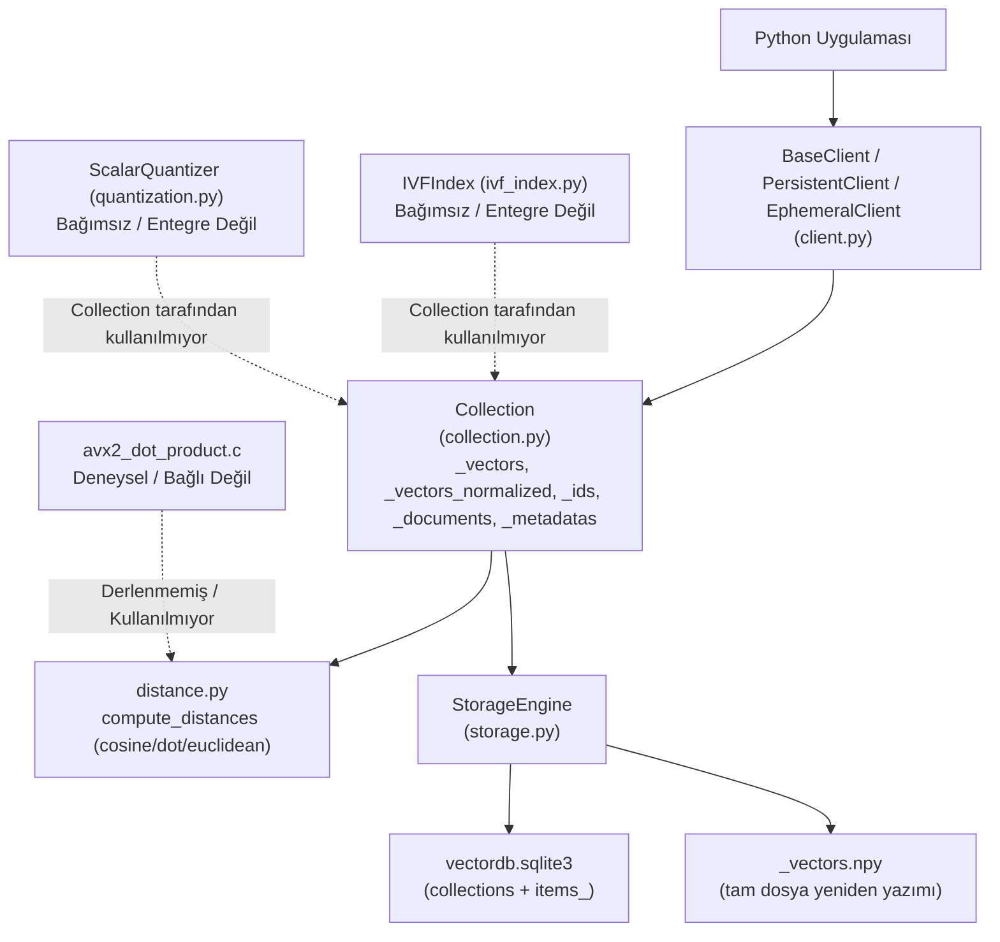

# MicroVectorDB v0.2.0 — Derinlemesine Mimari ve Performans Denetim Raporu (`ARCHITECTURE_AUDIT.md`)

**Denetim Tarihi:** 2026-11-20  
**İncelenen Sürüm:** `v0.2.0` (commit `218a75c`)  
**Depo Kapsamı:** 22 dosya, 2.812 satır kod (`microvectordb/`, `tests/`, `examples/`, `kernels_experimental/`)  
**Ölçüm Donanımı ve Ortamı:** Windows 10/11 x86-64, Intel 12 mantıksal çekirdek (AVX2, FMA3, F16C, POPCNT), 15.73 GB RAM (ölçüm anında 2.81 GB boş), Python 3.11.9, NumPy 2.0.2 (OpenBLAS 0.3.27, 64-bit int, MAX_THREADS=24)

---

## 1. Yönetici Özeti

MicroVectorDB v0.2.0, yalnızca `numpy` bağımlılığı ile çalışan, temiz ve anlaşılır ChromaDB benzeri bir API sunan **başlangıç düzeyi bir gömülü vektör deposudur**. Mevcut 27 birim testinin tamamı geçmekte ve küçük veri kümelerinde (≤10.000 vektör, 128D, filtresiz kosinüs araması) OpenBLAS SGEMV sayesinde **4.830 QPS (P50 = 0.190 ms)** gibi rekabetçi tek sorgu gecikmesi elde etmektedir.

Bununla birlikte, kod tabanının satır satır incelenmesi ve deneysel ölçümler sonucunda **üretim ortamına geçişi ve 100K–1M+ vektör ölçeklenmesini engelleyen kritik mimari eksikler, doğruluk hataları ve güvenlik açıkları** tespit edilmiştir:

- **En Kritik Performans Bulguları (Ölçülmüş):**
  - **Metadata filtrelemeli arama 21x yavaşlamaktadır:** 100K×128D kosinüs aramasında filtresiz **2.814 ms (347.6 QPS)** iken %10 seçicilikli basit bir eşitlik filtresi (`where={"cat": "c0"}`) **59.317 ms (15.9 QPS)** sürmektedir.
  - **Öklid (L2) araması 13.7x–15.6x yavaşlamaktadır:** 50K×768D kosinüs **7.451 ms (124.9 QPS)** iken Öklid **116.301 ms (8.6 QPS)** sürmektedir (her sorguda tüm matrisin karesi yeniden hesaplanıp geçici ~150 MB kopya üretilmektedir).
  - **Artımlı (incremental) kalıcı yazma $O(N^2)$ karmaşıklıktadır:** 20 adet 500'lük batch eklemesinde (toplam 10K vektör) 20. batch 1. batch'ten **9.4x daha yavaştır** (18.9 ms → 178.6 ms); tek bir öğe silmek **225.4 ms** sürmektedir.
  - **Kosinüs modu belleği 2 katına çıkarmaktadır:** 50K×768D için ham vektörler ~146.5 MB iken kosinüs normalizasyon önbelleği nedeniyle bellek artışı **+297.4 MB** olmaktadır.
  - **`IVFIndex` ve `ScalarQuantizer` koleksiyona entegre değildir** ve her ikisinde de ciddi doğruluk/hız hataları vardır (`ScalarQuantizer` 100K×128D'de **35.075 ms / 27 QPS** ile Float32'den **12.5x yavaştır** ve `int16` taşma hatası nedeniyle Recall@10 = **0.630**'a düşmektedir).
- **En Kritik Güvenlik ve Veri Bütünlüğü Bulguları (Doğrulanmış):**
  - **Path Traversal açığı:** `storage.py:96,110,127` koleksiyon adını doğrulamadan `f"{coll_name}_vectors.npy"` yolu oluşturur.
  - **SQLite tablo adı çakışması:** `"my-docs"` ve `"my_docs"` aynı `items_my_docs` tablosuna eşlenir; sessiz veri karışması ve silinmesi doğrulanmıştır.
  - **Çökme anında veri bozulması (Crash Desync):** `.npy` atomik yazılmamakta, SQLite ile `.npy` ayrı işlemlerde güncellenmekte ve `collection.py:91-93` satır sayısı uyuşmazlığını `pass` ile yutmaktadır.
  - **Eşzamanlılık güvenliği yok:** SQLite `check_same_thread=False` ile açılmış ancak hiçbir kilit (lock) eklenmemiştir.

---

## 2. Mevcut Mimari Haritası



---

## 3. 14 Bileşen Üzerinden Detaylı Kod İncelemesi

| # | Bileşen | Mevcut Durum (v0.2.0) | Tespit Edilen Eksikler ve Kusurlar |
|---|---|---|---|
| 1 | **Core Database Architecture** | Tek katmanlı `Client -> Collection -> StorageEngine` yapısı. | `core/`, `indexes/`, `filtering/`, `quantization/` ayrımı yok; `Collection` 492 satırda depolama, filtreleme, önbellek ve arama sorumluluklarını karıştırıyor. |
| 2 | **Vector Storage Engine** | RAM'de `float32` `np.ndarray`; diskte `np.save` (`.npy`). | Kapasite ön-ayırma yok (`np.vstack` her eklemede tam kopya); yalnızca `float32` destekli; `use_mmap=True` `Collection` tarafından hiç kullanılmıyor; format sürümleme/header/checksum yok. |
| 3 | **Indexing Algorithms** | `Collection` yalnızca exact brute-force (Flat) kullanır. `IVFIndex` ayrı bir sınıftır. | HNSW yok (`pyproject.toml`'da opsiyonel `hnswlib` tanımlı ama kod yok); Disk tabanlı indeks yok; `IVFIndex` sadece L2 destekler, K-Means++ yerine rastgele seçim yapar, `nprobe == n_clusters` durumunda `ValueError` ile çöker, diske kaydedilemez. |
| 4 | **Similarity Search Algorithms** | `cosine`, `dot_product`, `euclidean` BLAS `np.dot` ve `argpartition` Top-K. | `euclidean` her sorguda tüm DB matrisinin karesini yeniden hesaplar; `cosine` tüm matrisi ikinci kez kopyalayan `_vectors_normalized` kullanır; NumPy 1.x'te `np.where(norms == 0, 1.0, norms)` `float64` terfisine yol açar; sparse/hybrid arama yok. |
| 5 | **Metadata Management** | RAM'de `List[Optional[Dict]]`, SQLite'ta JSON `TEXT` sütunu. | Hiçbir ters indeks (inverted index) veya sütun indeksi yok; her yazmada tüm kayıtların JSON serileştirmesi baştan yapılır. |
| 6 | **Persistence Mechanism** | SQLite (`vectordb.sqlite3`) + koleksiyon başına bir `.npy` dosyası. | Her `add`/`upsert`/`delete` tüm `.npy` ve tüm SQLite tablosunu baştan yazar ($O(N)$ per op); atomik yazma yok; WAL yok; `EphemeralClient` bile bellek içi SQLite'a her işlemde tüm kayıtları JSON olarak yazar; `close()` istemcide açık değil. |
| 7 | **Memory Management** | Tüm vektörler, normalizasyon kopyası, dokümanlar ve metadata sözlükleri tamamen RAM'de. | Kosinüs modunda **2x vektör RAM'i**; `np.vstack` sırasında **3x tepe RAM**; filtreli kosinüs aramasında aday vektörlerin **çift kopyası**; sıkıştırılmış depolama (`float16`/`int8`/`binary`) `Collection` içinde yok. |
| 8 | **Query Execution** | Sabit akış: Python metadata taraması -> fancy indexing kopyası -> `compute_distances` -> `argpartition`. | Sorgu planlayıcısı (Query Optimizer) yok; pre-filter / post-filter maliyeti hesaplanmıyor; `score_threshold` yok; `query` boyut doğrulaması yapmıyor (ham NumPy `ValueError` fırlatıyor). |
| 9 | **Filtering Engine** | `Collection._matches_filter`: `$eq`, `$ne`, `$gt`, `$gte`, `$lt`, `$lte`, `$in`, `$nin`. | `$and`, `$or`, `$not` ve iç içe (`nested`) filtreler yok; karma veri tiplerinde (`str < int`) `TypeError` ile çöküyor; indeksleme olmadığı için 100K kayıtta her sorguda 100K Python döngüsü çalışıyor. |
| 10 | **Error Handling** | 5 özel hata sınıfı (`VectorDBError` hiyerarşisi). | `NaN`/`Inf` kontrolü yok; aynı `add()` çağrısındaki tekrarlanan ID'ler yakalanmıyor ve RAM'i bozuyor; geçersiz `metric` `create_collection` anında değil `query` anında hata veriyor; `add([], [])` boş listede çöküyor. |
| 11 | **Concurrency** | `sqlite3.connect(..., check_same_thread=False)` dışında **sıfır** senkronizasyon. | `RWLock` veya `Mutex` yok; eşzamanlı okuma/yazma `IndexError`, yarış durumu (race condition) ve SQLite `ProgrammingError` üretir; paralel/async sorgu yürütme yok. |
| 12 | **API Design** | ChromaDB uyumlu `PersistentClient`/`EphemeralClient`, `Collection.add/upsert/query/get/delete/count/peek`. | `MicroVectorDB` kısa yolu, `collection.search()`, `score_threshold`, `index_type`, `quantization`, context manager (`with client:`), `close()`, `flush()` / `checkpoint()` eksik. |
| 13 | **Python Integration** | Saf Python 3.8+ ve `numpy>=1.20`. `pyproject.toml` ve `setup.py` mevcut. | `setup.py` ve `pyproject.toml` dublike; `requirements.txt` yalnızca `numpy>=1.20.0`; opsiyonel bağımlılık yönetimi (`[hnsw]`, `[server]`, `[bench]`) geliştirilebilir; `kernels_experimental/` projeye bağlı değil. |
| 14 | **Test Infrastructure** | `unittest` ile 27 birim testi (`test_microvectordb.py`, `test_optimizations.py`). | Eşzamanlılık, çökme kurtarma (recovery), veri bozulması, sınır değer (`NaN`/`Inf`, boş koleksiyon, tekrarlanan ID, karma tip filtre), ölçek/stres, bellek sızıntısı ve otomatik benchmark testleri yok. Mevcut testlerde `IVF` recall eşiği `0.3`, `ScalarQuantizer` overlap eşiği `2/10` gibi aşırı gevşek bırakılmış (altta yatan bug'ları gizlemiş). |

---

## 4. Temel Mimari Sorulara Bilimsel Cevaplar

1. **Mevcut arama algoritmasının zaman karmaşıklığı nedir?**
   - Filtresiz `Collection.query()` (Flat): $O(Q \cdot N \cdot D + Q \cdot N)$ (`np.dot` + `np.argpartition` ile $O(N)$ Top-K).
   - Filtreli `Collection.query()`: $O(N \cdot F + M \cdot D + Q \cdot M \cdot D)$ ($F$: filtre koşul sayısı, $M$: eşleşen kayıt sayısı); ancak Python döngüsü ve iki kez $M \times D$ fancy-indexing bellek kopyası sabit katsayıyı 20x+ büyütmektedir.
   - `Collection.get(ids=...)`: $O(N \cdot |ids|)$ (çünkü `s_id not in ids` liste taraması yapılır, `_id_to_idx` kullanılmaz!).
   - Artımlı `add()` ($B$ batch, toplam $N$ vektör): $O(B \cdot N \cdot D)$ bellek kopyası + $O(B \cdot N)$ SQLite/disk yazımı; tekil eklemelerde ($B = N$) **$O(N^2 \cdot D)$**.

2. **Veri büyüklüğü arttığında performans nasıl değişiyor? (Ölçülmüş v0.2.0 Baseline)**

| Senaryo (v0.2.0) | Vektör ($N$) | Boyut ($D$) | Metrik | Filtre | Ekleme Süresi | İlk Sorgu | P50 (ms) | P95 (ms) | P99 (ms) | QPS | $\Delta$RAM (MB) |
|---|---:|---:|---|---|---:|---:|---:|---:|---:|---:|---:|
| Flat Ephemeral | 10,000 | 128 | cosine | Yok | 0.041 s | 5.09 ms | 0.190 | 0.298 | 0.487 | 4,829.7 | +14.2 |
| Flat Ephemeral | 50,000 | 128 | cosine | Yok | 0.225 s | 17.25 ms | 1.352 | 1.825 | 1.899 | 710.2 | +62.0 |
| Flat Ephemeral | 100,000 | 128 | cosine | Yok | 0.434 s | 34.00 ms | 2.814 | 3.533 | 3.660 | 347.6 | +114.5 |
| Flat Ephemeral | 100,000 | 128 | cosine | %10 (`cat=c0`) | 0.441 s | 64.90 ms | **59.317** | 105.245 | 109.948 | **15.9** | +110.7 |
| Flat Ephemeral | 100,000 | 128 | euclidean | Yok | 1.322 s | 29.41 ms | **38.538** | 62.661 | 70.832 | **24.8** | +59.1 |
| Flat Ephemeral | 100,000 | 128 | dot_product | Yok | 1.372 s | 3.98 ms | 3.748 | 7.221 | 11.817 | 229.5 | +61.4 |
| Flat Ephemeral | 50,000 | 768 | cosine | Yok | 0.750 s | **183.80 ms** | 7.451 | 11.716 | 16.291 | 124.9 | **+297.4** |
| Flat Ephemeral | 50,000 | 768 | euclidean | Yok | 0.641 s | 106.06 ms | **116.301** | 150.037 | 154.313 | **8.6** | +158.6 |
| Standalone `IVFIndex` (256, nprobe=8) | 100,000 | 128 | euclidean | Yok | 7.15 s (train) | — | 2.102 | 3.355 | — | 429.8 | Recall@10 = **0.149** |
| Standalone `ScalarQuantizer` | 100,000 | 128 | euclidean | Yok | — | — | **35.075** | — | — | **27.0** | Recall@10 = **0.630** |
| Referans: FAISS `IndexFlatIP` | 100,000 | 128 | cosine | Yok | 0.063 s | — | 3.482 | 5.016 | — | 269.8 | Recall@10 = 1.000 |
| Referans: `hnswlib` (M=16, efS=64) | 100,000 | 128 | cosine | Yok | 19.60 s (build) | — | **0.308** | — | — | **2,812.3** | — |

3. **RAM kullanımı hangi noktalarda artıyor?**
   - **Kosinüs normalizasyon kopyası:** `self._vectors` ($4ND$) + `self._vectors_normalized` ($4ND$) = **$8ND$ byte** (1M×768D için **6.14 GB** sadece vektör matrisi!).
   - **`np.vstack` tepe belleği:** Ekleme anında eski matris + yeni blok + birleştirilmiş yeni matris aynı anda bellekte tutulur (**~2x–3x tepe RAM**).
   - **Öklid sorgu geçici belleği:** `db_vectors ** 2` her sorguda ek bir $4ND$ byte geçici dizi ayırır.
   - **Filtreli sorgu kopyaları:** `sub_vectors` + `full_norm[candidate_indices]` = eşleşen alt kümenin **2x kopyası**.
   - **Python nesne yükü:** Her kayıt için Python `str` ID, `dict` metadata ve `str` doküman (~300–600 byte/kayıt ekstra overhead; 1M kayıtta ~400–600 MB).
   - **`EphemeralClient` bellek içi SQLite kopyası:** Tüm ID, doküman ve JSON metadata ayrıca `:memory:` SQLite içinde ikinci kez tutulur!

4. **Vektörler nasıl saklanıyor?**
   - RAM'de C-contiguous `float32` 2B NumPy dizisi (`(N, D)`).
   - Diskte `{coll_name}_vectors.npy` (sıkıştırmasız, sürüm headersız, atomik olmayan tek parça `.npy`).

5. **Diskten veri okuma işlemleri ne kadar verimli?**
   - Açılışta `np.load` ile tüm `.npy` ve `SELECT ... ORDER BY int_id ASC` ile tüm SQLite satırları (JSON `loads` ile) **tamamen RAM'e yüklenir**. 10K×128D yükleme **114.9 ms** sürmüştür. `use_mmap=True` `StorageEngine`'de tanımlı olsa da `Collection` tarafından **hiç etkinleştirilememektedir**.

6. **İndeksleme sırasında darboğaz nerede oluşuyor?**
   - `Collection.add()` içinde darboğaz: (a) her çağrıda `_persist()` ile tüm $N$ kaydın JSON serileştirilip SQLite'a tekrar yazılması, (b) `.npy` dosyasının baştan yazılması, (c) `np.vstack` tam matris kopyası. 20×500 artımlı kalıcı eklemede hız 230K v/s'den **5.134 v/s**'ye düşmektedir (**45x yavaşlama**).
   - `IVFIndex.train()` içinde darboğaz: K-Means döngüsünde her iterasyonda $K$ küme için $K$ kez `mask = assignments == c` + `vectors[mask].mean(axis=0)` yapılması (100K×128D, 256 küme, 15 iterasyon = **7.15 s**).

7. **Metadata filtreleme aramayı ne kadar yavaşlatıyor?**
   - 100K×128D %10 seçicilikli basit filtrede **2.814 ms → 59.317 ms (21.1x yavaşlama; QPS 347.6 → 15.9)**! Tek başına tüm sistemin en kötü çalışma zamanı darboğazıdır.

8. **Aynı anda birden fazla sorgu geldiğinde sistem nasıl davranıyor?**
   - Yalnızca salt-okunur sorgular OpenBLAS içinde GIL'i bırakır ancak `_get_normalized_vectors()` lazy başlatmasında yarış durumu (iki thread aynı anda normalize eder) bulunur. Herhangi bir eşzamanlı `add()`/`upsert()`/`delete()` sırasında **hiçbir kilit olmadığı için** `_ids`, `_vectors`, `_metadatas` boyutları anlık uyumsuzluğa düşerek `IndexError` veya sessiz yanlış sonuç üretir; paylaşılan SQLite bağlantısı da `ProgrammingError` riski taşır.

9. **Veri bozulması veya beklenmedik kapanma durumunda ne oluyor?**
   - **Yüksek veri kaybı/bozulma riski:** `np.save()` hedef dosyayı doğrudan kesip (truncate) üzerine yazar; yazma ortasında kesinti tüm vektör dosyasını yok eder. SQLite ile `.npy` arasında transaction/WAL atomikliği yoktur; yükleme aşamasında satır uyuşmazlığı sessizce `pass` ile geçiştirilir (`collection.py:91-93`).

10. **Mevcut mimari milyonlarca vektöre çıkabilecek durumda mı?**
    - **Hayır.** 1M × 768D `float32` + kosinüs cache = **6.14 GB** sadece vektörler + ~1 GB metadata/SQLite + `np.vstack` tepe belleği = **>10 GB RAM** (mevcut 15.73 GB sistemde OOM riski). Ayrıca Flat arama 1M × 768D'de sorgu başına ~150 ms (~6 QPS), filtreli arama >600 ms, her yeni ekleme ise 3 GB'lık `.npy` dosyasını baştan yazarak **dakikalarca** bloklar.

---

## 5. En Büyük 10 Performans Darboğazı (Öncelik Sırasıyla)

| Sıra | Darboğaz | Konum | Ölçülen / Analitik Etki | Kök Neden |
|---:|---|---|---|---|
| **1** | **Filtreli aramada $O(N)$ Python taraması + çift vektör kopyası** | `collection.py:332-365` | 100K×128D'de **21.1x yavaşlama** (2.81 ms → **59.32 ms**, 15.9 QPS) | Ters metadata indeksi yok; `self._vectors[idx]` ve `full_norm[idx]` iki kez fancy-indexing kopyası yapıyor; `sub_ids/docs/metas` tam listeleri oluşturuluyor. |
| **2** | **Her yazmada tam DB yeniden yazımı (`_persist()`)** | `collection.py:104-118`, `storage.py:106-168` | 20×500 artımlı eklemede **45x yavaşlama** (5.1K v/s); tekil silme **225 ms**; 20. batch 1.'den **9.4x yavaş** | Tüm `.npy` baştan yazılıyor (`.astype` kopyasıyla) ve tüm $N$ satır SQLite'a yeniden JSON-serileştirilip upsert ediliyor (`EphemeralClient`'ta bile!). |
| **3** | **Öklid mesafesinde her sorguda `db_vectors ** 2` yeniden hesabı** | `distance.py:74` | 50K×768D'de **15.6x yavaşlama** (116.3 ms vs 7.45 ms kosinüs); her sorguda +150 MB geçici RAM | `||d||^2` ($4N$ byte) önbelleklenmiyor, her sorguda $N \times D$ eleman karesi alınıp toplanıyor. |
| **4** | **Kosinüs modunda 2x vektör RAM'i ve tam cache sıfırlama** | `collection.py:56-77, 174` | 50K×768D'de **+297.4 MB RAM** (2x); ilk sorguda **183.8 ms** gecikme artışı | Tam `(N, D)` normalize kopya tutuluyor (`inv_norms` $(N,)$ yerine); tek bir `add()` tüm cache'i çöpe atıyor. |
| **5** | **Koleksiyona entegre ANN indeksi (HNSW / Optimize IVF) yokluğu** | `collection.py:293-398` | 100K+ vektörde $O(N \cdot D)$ doğrusal artış (Flat 348 QPS vs HNSW 2,812 QPS = **8.1x fark**, 1M'de **>50x**) | `IVFIndex` bağlantısız, HNSW implemente edilmemiş, Query Optimizer yok. |
| **6** | **Dinamik kapasite tamponu olmadan `np.vstack` kullanımı** | `collection.py:170, 239` | Artımlı eklemede $O(N^2 D)$ bellek kopyası ve 2x–3x tepe RAM | Her `add()` tüm vektör matrisini yeniden tahsis edip kopyalıyor. |
| **7** | **`ScalarQuantizer` int16 taşması + BLAS'sız 6x geçici kopya** | `quantization.py:124-130` | **35.08 ms (27 QPS)** — Float32'den **12.5x yavaş** ve Recall@10 = **0.630** | `diff ** 2` `int16`'da taşıyor (`[-25536, -511]`); ölçek katsayısı (`range_vals`) ihmal ediliyor; her sorguda 3 adet `int16` matris kopyası yapılıyor. |
| **8** | **`IVFIndex` bitişik olmayan bellek düzeni ve `linalg.norm` kullanımı** | `ivf_index.py:74-80, 140-156` | Train 7.15 s; search 2.10 ms (Flat'a yakın) ama Recall@10 sadece **0.149** | Kümeler bellekte bitişik değil (her sorguda scatter-gather kopya); BLAS yerine `linalg.norm(candidates - query)`; rastgele başlangıç merkezleri; sadece L2. |
| **9** | **`Collection.get(ids=...)` $O(N \cdot |ids|)$ doğrusal tarama** | `collection.py:411-413` | 100K kayıtta 1K ID çekmek $10^8$ karşılaştırma | `_id_to_idx` sözlüğü zaten mevcutken kullanılmıyor, liste üzerinde `in` aranıyor. |
| **10** | **`use_mmap` bağlantısızlığı ve sıkıştırılmış depolama eksikliği** | `collection.py:90`, `storage.py:113` | Büyük veri setlerinde OOM; RAM'den büyük koleksiyonlar açılamıyor | `float16`/`int8`/`binary` depolama yok; `load_vectors(..., use_mmap=True)` hiç çağrılmıyor. |

---

## 6. Doğrulanmış Hatalar, Güvenlik Açıkları ve Veri Bütünlüğü Riskleri

| Öncelik | Kategori | Bulgu | Konum | Deneysel Doğrulama |
|---|---|---|---|---|
| **P0 (Kritik)** | **Güvenlik** | **Path Traversal:** `coll_name = "../../hedef"` ile `persist_dir` dışına dosya yazma/silme | `storage.py:96,110,127` | Kod incelemesi ile kesin doğrulandı (`os.path.join` doğrulamasız) |
| **P0 (Kritik)** | **Veri Bütünlüğü** | **Tablo Adı Çakışması:** `"my-docs"` ve `"my_docs"` aynı `items_my_docs` tablosunu paylaşır | `storage.py:49-52` | Doğrulandı: `"my-docs"` eklemesi `"my_docs"` tablosunda göründü (`collide=True`) |
| **P0 (Kritik)** | **Veri Bütünlüğü** | **Çökme Bozulması:** Atomik olmayan `.npy` yazımı + SQLite/npy uyumsuzluğunun `pass` ile yutulması | `storage.py:111`, `collection.py:91-93` | Kod incelemesi ile kesin doğrulandı |
| **P0 (Kritik)** | **Doğruluk** | **`ScalarQuantizer` `int16` karesi taşması:** `|diff| >= 182` için negatif kareler | `quantization.py:128` | Doğrulandı: `np.array([-200,200,255], int16)**2 -> [-25536, -25536, -511]` |
| **P0 (Kritik)** | **Doğruluk** | **`IVFIndex` `argpartition` çökmesi:** `nprobe >= n_clusters` olduğunda `ValueError` | `ivf_index.py:142` | Doğrulandı: `ValueError: kth(=4) out of bounds (4)` |
| **P1 (Yüksek)** | **Veri Bütünlüğü** | **Batch içi tekrarlanan ID:** `add(["x", "x"], ...)` sessizce geçip `_ids` ile `_id_to_idx`'i bozar | `collection.py:155-166` | Doğrulandı: `count=2, id_to_idx={'x': 1}` |
| **P1 (Yüksek)** | **Doğruluk** | **`NaN`/`Inf` zehirlenmesi:** Geçersiz float değerleri reddedilmez, sıralamayı bozar | `collection.py:133,186` | Doğrulandı: `sims=[1.0, nan]` |
| **P1 (Yüksek)** | **Kararlılık** | **Karma tip filtre çökmesi:** `str` metadata üzerinde `$gte: 100` `TypeError` fırlatır | `collection.py:271-278` | Doğrulandı: `TypeError: '<' not supported between 'str' and 'int'` |
| **P1 (Yüksek)** | **Eşzamanlılık** | **Sıfır thread güvenliği:** `check_same_thread=False` var ama hiç lock yok | `storage.py:29`, `collection.py` | Kod incelemesi ile doğrulandı |
| **P2 (Orta)** | **Kararlılık** | SQLite `IN (...)` > 32,766 ID silmede `OperationalError`; geçersiz `metric` geç yakalanıyor; `add([],[])` çöküyor; `Client.close()` yok | `storage.py:192`, `client.py:40`, `collection.py:133` | Kod incelemesi ile doğrulandı |

---

## 7. Rakip Vektör Veritabanları ile Teknik Mimari Karşılaştırması

| Mimari Boyut | MicroVectorDB v0.2.0 | **Qdrant** (Rust) | **Milvus** (Go/C++) | **ChromaDB** (Python/Rust) | **FAISS** (C++) | **LanceDB** (Rust/Arrow) |
|---|---|---|---|---|---|---|
| **Çekirdek Dil** | Python + NumPy (OpenBLAS) | Rust (SIMD/AVX2/NEON) | C++ (Knowhere) + Go | Python + Rust (`hnswlib`/SQLite) | C++ (BLAS/SIMD/CUDA) | Rust + Apache Arrow (Lance) |
| **Depolama Motoru** | SQLite + tam `.npy` yazımı | Segment + mmap + WAL | MinIO/S3 + Pulsar/Kafka + etcd | SQLite + hnswlib bin dosyaları | Yok (yalnızca bellek/dosya dump) | Sütunsal Lance formatı (NVMe/S3) |
| **İndeksleme** | Yalnızca Flat (IVF entegre değil) | Filtre-farkında HNSW | IVF, HNSW, DiskANN, SCANN | HNSW | Flat, IVF, HNSW, PQ, OPQ, SQ | IVF-PQ, HNSW-SQ (disk-first) |
| **Kuantizasyon** | Entegre değil (bug'lı SQ) | Scalar (INT8), Binary, Product | SQ8, PQ, Binary | Yok | SQ, PQ, OPQ, Residual, Binary | PQ, SQ, Binary |
| **Metadata Filtreleme** | $O(N)$ Python döngüsü | Payload inverted/range index + HNSW içi filtreleme | Bitset pre-filtering + inverted index | SQLite + ID bitset | Yok | DataFusion SQL + inverted/bitmap |
| **Hibrit / Sparse** | Yok | Sparse vektör + BM25 + RRF | Sparse (BMP/BM25) + RRF | Full-text LIKE (sınırlı) | Yok | Tantivy FTS + RRF |
| **Dayanıklılık (WAL/Crash)** | Yok (yüksek bozulma riski) | WAL + Segment atomic commit + Snapshot | Dağıtık WAL + Snapshot | SQLite WAL + segment log | Kullanıcı sorumluluğunda | MVCC versiyonlu atomik yazma |
| **Dağıtım Ağırlığı** | Çok hafif (~1 MB, `numpy`) | Sunucu/Docker (~50 MB) | Ağır mikroservis kümesi | Ağır (~300+ MB; NumPy 2.0 uyumsuzlukları görüldü*) | Orta (wheel/conda) | Orta (Rust binary wheel) |

*\*Not: Bu makinede kurulu `chromadb 0.5.0`, `numpy 2.0.2` üzerinde `AttributeError: np.float_ was removed` hatasıyla içe aktarılamamıştır. MicroVectorDB'nin sıfır ağır bağımlılık ve modern NumPy 2.x uyumluluğu gerçek bir geliştirici deneyimi avantajıdır.*

### MicroVectorDB'nin Kazanabileceği Stratejik Niş

MicroVectorDB, distributed Kubernetes kümelerinde Milvus veya Rust çekirdekli uzak sunucu Qdrant ile ham C++/Rust mikro-saniye yarışına girmek yerine şu **gerçekçi ve yüksek değerli kullanım senaryolarında** en iyi seçenek olmayı hedeflemelidir:
1. **Gömülü (Embedded) Python RAG & AI Agent Hafızası:** Kurulumu 2 saniye süren, yalnızca `numpy` ile çalışan, sıfır daemon gerektiren, **düşük RAM tüketimli** (Float16 / INT8 / Binary + mmap + `inv_norms` kosinüs) üretim sınıfı yerel vektör veritabanı.
2. **Filtreli Aramada Üstün Hız:** Ters metadata indeksi + bitset/indeks kesişimi + sıfır kopya aday değerlendirmesi ile 10K–1M arası filtreli RAG sorgularında ultra düşük gecikme.
3. **Hibrit Arama + RAG İlkelleri:** Tek pakette Dense + BM25/Sparse + RRF + Parent-Child + Deduplication + Harici Reranker kancası.
4. **Opsiyonel Hızlandırma Katmanı:** Çekirdek yalnızca `numpy` gerektirirken, kurulu olduğunda `hnswlib` / `faiss` veya derlenmiş SIMD çekirdeklerinden otomatik yararlanan modüler indeks motoru.

---

## 8. Önerilen Yeni Nesil Modüler Mimari (v0.3 → v1.0)

Gereksiz soyutlamadan kaçınarak, mevcut `microvectordb` paketini **%100 geriye dönük uyumlu** biçimde aşağıdaki modüler yapıya evriltiyoruz:

```text
microvectordb/
├── __init__.py                 # Geriye dönük uyumlu ana exportlar + MicroVectorDB alias
├── types.py                    # Veri yapıları, QueryResult, SearchResult, özel hatalar
├── client.py                   # PersistentClient, EphemeralClient, MicroVectorDB
├── collection.py               # Yüksek seviyeli Collection koordinatörü (RWLock korumalı)
├── distance.py                 # Geriye dönük uyumlu facade -> metrics/
├── ivf_index.py                # Geriye dönük uyumlu facade -> indexes/ivf.py
├── quantization.py             # Geriye dönük uyumlu facade -> quantization/
├── storage.py                  # Geriye dönük uyumlu facade -> storage/
├── metrics/
│   ├── __init__.py
│   └── kernels.py              # Cosine (inv_norms), Euclidean (cached sq_norms), Dot, batch/chunk
├── storage/
│   ├── __init__.py
│   ├── vector_buffer.py        # Dinamik kapasite tamponu (amortized O(1) append, float32/float16/int8/binary)
│   ├── binary_format.py        # Sürümlü .mvdbvec (64B header + CRC32 + append + mmap + v0.2 .npy migration)
│   ├── engine.py               # Güvenli SQLite (WAL, hash'li tablo adları, delta writes) + atomik disk
│   └── wal.py                  # Write-Ahead Log & crash recovery (Faz 4)
├── indexes/
│   ├── __init__.py
│   ├── base.py                 # Minimal BaseIndex protokolü
│   ├── flat.py                 # Optimize Exact/Flat indeks (inv_norms + sq_norms + quantized rescore)
│   ├── ivf.py                  # K-Means++ + bitişik küme blokları + tüm metrikler + BLAS
│   ├── hnsw.py                 # Opsiyonel hnswlib adaptörü + pure-NumPy fallback/plan (Faz 2)
│   └── optimizer.py            # Query Optimizer: indeks seçimi, pre/post-filter maliyet tahmini (Faz 2)
├── quantization/
│   ├── __init__.py
│   ├── scalar.py               # Taşmasız, ölçek-ağırlıklı INT8 SQ + quantile clipping
│   ├── float16.py              # Float16 sıkıştırma (2x RAM tasarrufu)
│   ├── binary.py               # Binary quantization (32x RAM tasarrufu, LUT popcount Hamming)
│   └── product.py              # Product Quantization (PQ, Faz 2)
├── filtering/
│   ├── __init__.py
│   └── metadata_index.py       # Ters indeks + $and/$or/$not + nested dot-path + güvenli tip kıyaslama
├── search/                     # Faz 3: sparse (BM25), hybrid (RRF/weighted), RAG helpers
├── concurrency/
│   ├── __init__.py
│   └── rwlock.py               # Reader-Writer Lock (çoklu okuyucu, tekil yazıcı)
├── api/                        # Faz 5: FastAPI REST server, auth, rate limit, metrics
└── benchmarks/                 # Bilimsel benchmark paketi (JSON/CSV/Markdown çıktı)
```

---

## 9. Önceliklendirilmiş Geliştirme Önerileri

### P0 — Acil (Faz 1: Çekirdek Optimizasyon, Güvenlik ve Doğruluk — Geriye Dönük Uyumlu)
1. **Güvenlik ve Bütünlük Düzeltmeleri:** Path traversal engelleme, SHA-256 hash'li çakışmasız tablo/dosya adları, atomik yazma + sürüm header'lı `.mvdbvec` (otomatik v0.2 `.npy` göçü ile), SQLite WAL + chunked delete, batch içi duplicate ID / `NaN` / `Inf` / metrik / boyut doğrulaması, `close()` ve context manager.
2. **Kosinüs `inv_norms` (2x → 1.001x RAM) ve Öklid `sq_norms` (~15x hızlanma):** Çift matris kopyasını ortadan kaldır, ilk sorgu gecikmesini 184 ms'den <10 ms'ye indir.
3. **Dinamik Vektör Tamponu + Artımlı (Delta) Kalıcılık + `EphemeralClient` Sıfır-SQLite Yolu:** $O(N^2)$ yazma darboğazını $O(M)$'e düşür.
4. **Ters Metadata İndeksi + Gelişmiş Filtre Motoru (`$and`, `$or`, `$not`, nested, güvenli kıyaslama):** 100K filtreli sorguyu 59 ms'den <2 ms'ye indir (>30x hızlanma).
5. **`IVFIndex` ve `ScalarQuantizer` Yeniden Tasarımı + `Float16`/`Binary` Quantizer + `Collection` Entegrasyonu:** `int16` taşma hatasını ve `argpartition` çökmesini gider, K-Means++ + bitişik küme bellek düzeni + BLAS ekle, `Collection`'a `index_type`, `quantization`, `use_mmap`, `score_threshold`, `search()` ve `RWLock` kazandır.
6. **Tekrarlanabilir Benchmark ve Genişletilmiş Test Altyapısı:** JSON/CSV çıktı üreten bilimsel benchmark betiği + eşzamanlılık, sınır değer, kurtarma ve regresyon testleri.

### P1 — Kısa Vade (Faz 2–3)
- `HNSWIndex` (opsiyonel `hnswlib` + kalıcılık + filtreli arama), Product Quantization (PQ), Query Optimizer (otomatik pre/post-filter ve indeks seçimi), Disk-tabanlı/Out-of-core arama.
- Sparse (BM25 / ters indeks), Hybrid arama (RRF + ağırlıklı füzyon), RAG ilkelleri (parent-child, deduplication, reranker arayüzü, multi-tenant).

### P2 — Orta Vade (Faz 4–5)
- Gerçek binary WAL + CRC32 + Crash Replay + Snapshot + Backup/Restore + Rollback garantileri.
- FastAPI üretim sunucusu, API Key kimlik doğrulama, rate limiting, `/health`, `/metrics`, Docker.

### P3 — Uzun Vade (Faz 6)
- SIFT1M / GloVe / BEIR üzerinde Qdrant / Milvus / LanceDB / FAISS ile büyük ölçekli (1M) karşılaştırma, C/Rust/Cython SIMD çekirdekleri, GPU ve dağıtık mimari araştırması.
