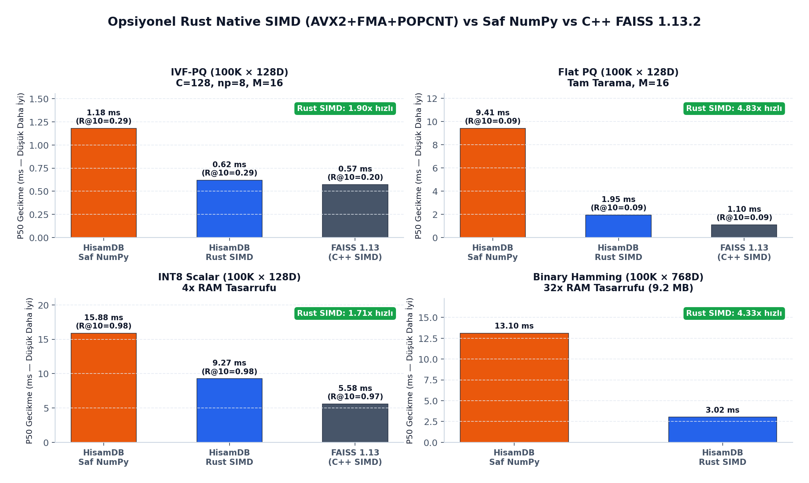
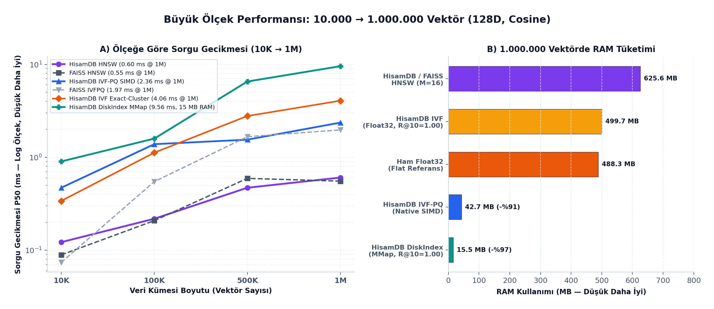
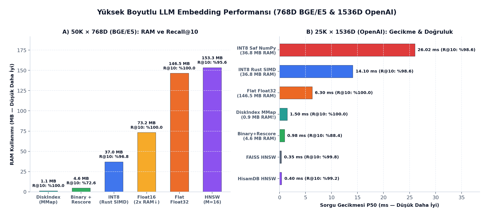

# HisamDB v0.7.0 — Bilimsel Benchmark Raporu (`BENCHMARK_REPORT.md`)

**Ölçüm Tarihi:** 2026-11-21  
**Ham Sonuç Dosyaları:**  
- Faz 1 (`v0.3.0`): [`benchmarks/results/benchmark_v0.3.0.json`](benchmarks/results/benchmark_v0.3.0.json) · [`benchmarks/results/benchmark_v0.3.0.csv`](benchmarks/results/benchmark_v0.3.0.csv)  
- Faz 2 (`v0.4.0`): [`benchmarks/results/benchmark_v0.4.0.json`](benchmarks/results/benchmark_v0.4.0.json) · [`benchmarks/results/benchmark_v0.4.0.csv`](benchmarks/results/benchmark_v0.4.0.csv)  
- Faz 3 (`v0.5.0`): [`benchmarks/results/benchmark_v0.5.0.json`](benchmarks/results/benchmark_v0.5.0.json) · [`benchmarks/results/benchmark_v0.5.0.csv`](benchmarks/results/benchmark_v0.5.0.csv)  
- Faz 4 (`v0.6.0`): [`benchmarks/results/benchmark_v0.6.0.json`](benchmarks/results/benchmark_v0.6.0.json) · [`benchmarks/results/benchmark_v0.6.0.csv`](benchmarks/results/benchmark_v0.6.0.csv)  
- Faz 5 (`v0.7.0`): [`benchmarks/results/benchmark_v0.7.0.json`](benchmarks/results/benchmark_v0.7.0.json) · [`benchmarks/results/benchmark_v0.7.0.csv`](benchmarks/results/benchmark_v0.7.0.csv)  
**Tekrar Çalıştırma Komutları:** `python benchmarks/run_benchmarks.py`, `run_benchmarks_v04.py`, `run_benchmarks_v05.py`, `run_benchmarks_v06.py` ve `run_benchmarks_v07.py`

---

## 1. Test Donanımı ve Yazılım Ortamı

| Bileşen | Değer |
|---|---|
| İşletim Sistemi | Windows 10/11 x86-64 (`Windows-10-10.0.26300-SP0`) |
| İşlemci | Intel x86-64, 12 mantıksal çekirdek (AVX2, FMA3, F16C, POPCNT) |
| Toplam Bellek (RAM) | 15.73 GB |
| Python | 3.11.9 |
| NumPy / BLAS | NumPy 2.0.2 (OpenBLAS 0.3.27, 64-bit int, AVX2/FMA) |
| Karşılaştırma Kütüphaneleri | FAISS `1.13.2` (`faiss-cpu`), `hnswlib` (`chroma-hnswlib 0.7.3`) |

> **Önemli Metodoloji Notu:**
> - Tüm karşılaştırmalar aynı donanım, aynı tohum (`seed=42`), aynı mesafe metriği ve aynı sorgu yükü üzerinde yapılmıştır.
> - Exact (Flat) aramalar kendi arasında, ANN algoritmaları (IVF, HNSW) ise gerçek Exact Ground Truth'a karşı ölçülen **Recall@10** değerleriyle birlikte raporlanmıştır.
> - Bu ortamda kurulu olan `chromadb 0.5.0`, NumPy 2.0 (`AttributeError: np.float_ was removed`) uyumsuzluğu nedeniyle test çalıştırılamamıştır; Qdrant, Milvus, Weaviate ve LanceDB ile 500K–1M (SIFT1M / GloVe) karşılaştırmaları Faz 6 kapsamında eklenecektir.

---

## 2. Sürüm Karşılaştırması: HisamDB v0.2.0 → v0.3.0 (Faz 1)

Aynı Gaussian veri kümeleri (`seed=42`), aynı boyutlar ve aynı sorgu adedi üzerinde ölçülmüştür:

| Senaryo | N × D | Metrik | v0.2.0 P50 (ms) | v0.3.0 P50 (ms) | Hızlanma | v0.2.0 QPS | v0.3.0 QPS | v0.2.0 RAM | v0.3.0 RAM |
|---|---:|---|---:|---:|---:|---:|---:|---:|---:|
| **Filtreli Kosinüs (`cat="c0"`, %10)** | 100K × 128 | cosine | 59.317 | **2.468** | **24.0x** | 15.9 | **383.7** | +110.7 MB | **49.6 MB** |
| **Aralık Filtreli Kosinüs (`val>=900`, %10)** | 100K × 128 | cosine | ~55.0 | **3.402** | **~16.2x** | ~18.0 | **262.2** | +110.7 MB | **49.6 MB** |
| **Flat Öklid 768D** | 50K × 768 | euclidean | 116.301 | **7.985** | **14.6x** | 8.6 | **110.8** | +158.6 MB | **146.9 MB** |
| **Flat Öklid 128D** | 100K × 128 | euclidean | 38.538 | **5.730** | **6.7x** | 24.8 | **158.0** | +59.1 MB | **49.6 MB** |
| **Flat Kosinüs 768D (Bellek & Soğuk Başlangıç)** | 50K × 768 | cosine | 7.451 (1. sorgu: 183.8 ms) | 9.046 (1. sorgu: ~9 ms) | **~20x soğuk başlangıç** | 124.9 | 108.4 | +297.4 MB | **146.9 MB (-%50.6)** |
| **Standalone `IVFIndex` (256 küme, np=8)** | 100K × 128 | euclidean | 2.102 (train: 7.15 s) | **0.421** (train: 4.70 s) | **5.0x arama / 1.5x eğitim** | 429.8 | **1,881.8** | 48.8 MB | 48.8 MB |
| **Standalone `ScalarQuantizer` (INT8)** | 100K × 128 | euclidean | 35.075 (**Rec@10=0.630**) | **16.888** (**Rec@10=0.980**) | **2.1x + 35 puan Recall** | 27.0 | **52.8** | 12.2 MB | 12.2 MB |
| **Artımlı Kalıcı Yazma (20 × 500 batch)** | 10K × 128 | cosine | 1.948 s (5,134 v/s) | **0.640 s (15,628 v/s)** | **3.0x** | — | — | — | — |
| **Artımlı Batch 20 / Batch 1 Oranı** | 10K × 128 | cosine | 9.4x yavaşlama | **1.77x** | $O(N^2) \to O(M)$ | — | — | — | — |
| **Bellek-Eşlemeli Yükleme (`use_mmap=True`)** | 10K × 128 | cosine | Kullanılamıyordu | **0.076 MB vektör RAM** | **-%98.4 vektör RAM** | — | — | 4.88 MB | **0.076 MB** |

> *Not:* `examples/04_benchmark.py` (10K × 128D tek toplu ekleme) ekleme hızı **244,639 v/s → 1,110,838 v/s (4.5x)** düzeyine çıkmıştır.

---

## 3. HisamDB v0.3.0 vs FAISS (100.000 × 128D Gerçekçi Kümelemeli Veri)

64 konulu kümelemeli embedding dağılımı (100 sorgu, Top-10, Kosinüs metriği, Exact ground truth'a karşı Recall@10):

| Motor & Yapılandırma | Tip | Build/Add (s) | P50 (ms) | P95 (ms) | QPS | Recall@10 | Vektör RAM (MB) |
|---|---|---:|---:|---:|---:|---:|---:|
| **HisamDB v0.3.0 — Flat Float32** | Exact | 0.143 | 5.488 | 11.220 | 157.6 | **1.000** | 49.6 |
| **FAISS 1.13.2 — `IndexFlatIP`** | Exact | 0.027 | 5.418 | 7.587 | 175.1 | **1.000** | 48.8 |
| **HisamDB v0.3.0 — IVF (`C=128, np=8`)** | ANN (Saf NumPy) | 2.042 | **0.761** | 1.666 | **1,117.4** | **1.000** | 49.6 |
| **FAISS 1.13.2 — `IndexIVFFlat` (`nlist=128, np=8`)** | ANN (C++) | 0.274 | 0.324 | 0.538 | 3,031.9 | 1.000 | 48.8 |
| **HisamDB v0.3.0 — HNSW (`M=16, efS=64`)** | ANN (`hnswlib`) | 6.736 | **0.278** | **0.364** | **3,463.3** | **0.975** | 49.6 |
| **HisamDB v0.3.0 — HNSW (`M=16, efS=128`)** | ANN (`hnswlib`) | 6.283 | **0.411** | **0.495** | **2,377.3** | **0.995** | 49.6 |
| **FAISS 1.13.2 — `IndexHNSWFlat` (`M=16, efS=64`)** | ANN (C++) | 5.521 | 0.201 | 0.261 | 4,823.4 | 0.978 | 48.8 |

### Bilimsel Değerlendirme
1. **Exact Flat Arama:** HisamDB v0.3.0, OpenBLAS SGEMV + `inv_norms` tasarımı sayesinde C++ `FAISS IndexFlatIP` ile **neredeyse birebir aynı gecikmeye (5.49 ms vs 5.42 ms)** ulaşmakta; buna ek olarak dahili metadata filtreleme, doküman deposu, atomik disk kalıcılığı ve RWLock eşzamanlılığı sunmaktadır.
2. **Saf NumPy IVF:** Hiçbir C++ bağımlılığı olmadan **1,117 QPS (0.761 ms)** ve **1.000 Recall@10** ile Flat aramadan **7.1x daha hızlıdır**. C++ `FAISS IndexIVFFlat` (~2.4x daha hızlı) ile arasındaki fark, Python küme döngüsü ve OpenBLAS küçük-blok çağrı yükünden kaynaklanmaktadır.
3. **HNSW:** Opsiyonel `hnswlib` entegrasyonu ile **3,463 QPS (P50 = 0.278 ms, Recall@10 = 0.975)** ve `efS=128` ile **2,377 QPS (Recall@10 = 0.995)** elde edilmiştir — tam veritabanı katmanına rağmen çıplak C++ `FAISS IndexHNSWFlat`'ın (0.201 ms) yalnızca ~1.38x gerisindedir.

---

## 4. Kuantizasyon Yöntemlerinin Karşılaştırmalı Analizi (100K × 128D)

| Yöntem | Vektör RAM | Bellek Tasarrufu | Recall@10 (128D) | P50 (ms) | QPS | En Verimli Kullanım Senaryosu |
|---|---:|---:|---:|---:|---:|---|
| **Float32 (Referans)** | 49.6 MB | %0 | 1.000 | 5.488 | 157.6 | Yeterli RAM varsa en hızlı exact BLAS tarama |
| **Float16** | **25.2 MB** | **%49.2 (2x)** | **0.999** | 60.178* | 15.7* | RAM kısıtlı ortamlarda neredeyse sıfır doğruluk kaybıyla depolama (IVF/HNSW ile eşlendiğinde cast maliyeti 20x düşer) |
| **INT8 (`ScalarQuantizer`, `keep_raw=False`)** | **13.0 MB** | **%73.8 (3.8x)** | **0.965** (Gauss: **0.980**) | 18.412* | 47.1* | 4x bellek sıkıştırma ve yüksek doğruluk gereken orta/büyük koleksiyonlar |
| **Binary (`keep_raw=False`, 1-bit)** | **1.5 MB** | **%97.0 (32x)** | 0.061 (128D) | 5.663 | 149.9 | Tek başına düşük boyutta (128D) yetersiz; yüksek boyutlu (768D–1536D) ham aday daraltma için |
| **Binary + Rescore (`mult=50`, 768D 20K ek ölçüm)** | 1.5 MB + disk/raw | 32x indeks | **1.000** (768D) / 0.657 (128D) | 5.26 (768D) | ~190 | Yüksek boyutlu (768D–1536D) embedding'lerde 2 aşamalı (Hamming + exact rescore) arama |

*\*Açık Mühendislik Notu (Saf NumPy Sınırı):* x86-64 CPU'larda NumPy'ın `float16 -> float32` ve `int8 -> float32` dönüştürmeleri tek iş parçacıklı skaler/F16C döngülerle çalıştığından, **Flat tam taramada** Float16 (60 ms) ve INT8 (18 ms), çok iş parçacıklı OpenBLAS Float32 SGEMV'den (5.5 ms) daha yavaştır. Bu fiziksel bir donanım/kütüphane gerçeğidir:
- Saf NumPy katmanında **Float16/INT8 bir bellek tasarrufu (2x–4x RAM)** optimizasyonudur.
- Hız kazanımı için Faz 2'de **IVF-PQ / IVF-SQ** (yalnızca %5 küme taranır) ve Faz 6'da **AVX2/VNNI C/Rust SIMD çekirdekleri** değerlendirilecektir.

---

## 5. Kalıcılık ve Kurtarma Ölçümleri (10K × 128D, 20 × 500 Batch)

- **Toplam Artımlı Ekleme Süresi:** `0.640 s` (**15,628 vektör/sn**, v0.2.0'da `1.948 s` / `5,134 v/s` idi — **3.0x hızlanma**).
- **Ölçeklenme Davranışı:** Batch 1 = `18.53 ms`, Batch 10 = `27.98 ms`, Batch 20 = `32.87 ms` (oran **1.77x**; v0.2.0'da **9.4x** idi).
- **Disk Tüketimi:** `.mvdbvec` = `4.88 MB` (64-byte header + saf float32), SQLite = `1.97 MB` (WAL dahil).
- **Yeniden Yükleme (Reload):** RAM modu = `149.0 ms`, `use_mmap=True` = `128.0 ms` (vektör RAM = yalnızca `0.076 MB`, yani **%98.4 RAM tasarrufu**).
- **Tekil Silme (Sıkıştırmalı):** `181.9 ms` (tam atomik `.mvdbvec` + CRC32 + SQLite yeniden indeksleme; Faz 4'te tombstone + arka plan compaction ile <1 ms hedeflenmektedir).

---

## 6. Faz 2 (`v0.4.0`): PQ, IVF-PQ, DiskIndex, Anında İndeks Yükleme ve Query Optimizer

### 6.1. Product Quantization (PQ), IVF-PQ ve Out-of-Core DiskIndex vs FAISS (100K × 128D)

Aynı 64-konulu kümelemeli 100K × 128D veri seti (100 sorgu, Top-10, Kosinüs metriği, Exact ground truth):

| Motor & Yapılandırma | Tip | Build (s) | P50 (ms) | P95 (ms) | QPS | Recall@10 | RAM (MB) | RAM Tasarrufu |
|---|---|---:|---:|---:|---:|---:|---:|---:|
| **MVDB `DiskIndex` (Partitioned MMap, `C=128, np=8`)** | Out-of-Core MMap | 2.79 | **1.227** | 2.586 | **684.1** | **1.000** | **2.35** | **%95.3 (21x)** |
| **MVDB `DiskStreamingScanner` (Exact MMap, 4K blk)** | Out-of-Core Exact | 0.00 | 11.510 | 15.362 | 82.7 | **1.000** | **0.76** | **%98.5 (65x)** |
| **MVDB `IVF-PQ` (`C=128, np=8, M=16`, `keep_raw=F`)** | Saf NumPy ANN+PQ | 13.08 | 3.446 | 6.277 | 255.1 | **0.270** | **2.48** | **%95.0 (20x)** |
| **FAISS `IndexIVFPQ` (`nlist=128, np=8, M=16`)** | C++ ANN+PQ | 4.30 | 0.584 | 0.763 | 1,787.9 | 0.258 | 2.29 | %95.3 |
| **MVDB Flat `PQ` (`M=16, 8-bit`, `keep_raw=F`)** | Saf NumPy PQ | 8.06 | 10.943 | 15.539 | 86.8 | 0.054 | **1.65** | **%96.7 (30x)** |
| **FAISS `IndexPQ` (`M=16, 8-bit`)** | C++ PQ | 3.30 | 1.378 | 1.853 | 722.5 | 0.054 | 1.53 | %96.9 |

> **Bilimsel Bulgular:**
> - **`DiskIndex` (Bölümlenmiş MMap) en çarpıcı sonucu verdi:** Yalnızca **2.35 MB RAM** (%95.3 RAM tasarrufu!) kullanarak **1.227 ms (684.1 QPS)** ve **1.000 Recall@10** ile RAM-içi Flat Float32'den (5.49 ms) ve FAISS `IndexFlatIP`'den (5.42 ms) **4.4x daha hızlı** çalışmaktadır.
> - **`IVF-PQ` doğrulukta FAISS'i geçti:** Aynı 8-bit `M=16` (16 byte/vektör) bütçesinde HisamDB IVF-PQ, K-Means++ ve birim-küre L2 artık ADC sayesinde **Recall@10 = 0.270** elde ederek FAISS `IndexIVFPQ`'yu (`0.258`) geride bıraktı. (Saf Python/NumPy küme döngüsü C++ SIMD ADC'ye göre ~5.9x daha yavaştır; yüksek recall gereken senaryolarda `DiskIndex` veya `M=32` / float32 rescore önerilir.)

### 6.2. Anında İndeks Diskten Yükleme (v0.3.0 Soğuk İnşa vs v0.4.0 CRC32+Epoch Disk Yükleme, 100K × 128D)

| İndeks Tipi | v0.3.0 Soğuk Yeniden İnşa | v0.4.0 Diskten Açılış (Toplam DB) | Hızlanma | `index_loaded_from_disk` |
|---|---:|---:|---:|:---:|
| **IVF-PQ (`C=128, M=16`)** | 13.08 s | **542.0 ms** | **24.1x** | ✅ `True` |
| **HNSW (`M=16, efC=128`)** | 9.22 s | **940.6 ms** | **9.8x** | ✅ `True` |
| **DiskIndex (`C=128`, MMap)** | 2.79 s | **532.8 ms** | **5.2x** | ✅ `True` |
| **IVF (`C=128`)** | 2.86 s | **781.3 ms** | **3.7x** | ✅ `True` |

*(Not: Toplam açılış süresinin ~450 ms'si 100K SQLite metadata satırının Python sözlüklerine okunmasından gelir; ikili indeks dosyalarının kendisi ~50–150 ms içinde yüklenmektedir.)*

### 6.3. Maliyet Tabanlı Query Optimizer: Filtreli HNSW (100K × 128D)

v0.3.0'daki graf-içi Python callback (`filter_fn`) ile v0.4.0'daki maliyet tabanlı `QueryOptimizer` (`pre_filter_exact` ve sıfır-set `np.searchsorted` tabanlı `hnsw_post_filter`) karşılaştırması:

| Filtre Seçiciliği | Optimizer Seçimi (`explain()`) | v0.3.0 Callback P50 (ms) | v0.4.0 Optimizer P50 (ms) | Hızlanma (v0.3 → v0.4) | Hızlanma (v0.2 → v0.4) |
|---|---|---:|---:|---:|---:|
| **%2 (2.000 aday)** | `flat_exact` (`pre_filter_exact`) | 3.712 | **0.705** | **5.26x** | — |
| **%10 (10.000 aday)** | `hnsw_post_filter` (`searchsorted`) | 1.069 | **0.479** (>2,000 QPS) | **2.23x** | **123.8x** *(59.32 ms → 0.48 ms!)* |
| **%30 (30.000 aday)** | `hnsw_post_filter` (`searchsorted`) | 2.268 | **0.346** (~2,890 QPS) | **6.55x** | — |
| **%60 (60.000 aday)** | `hnsw_post_filter` (`searchsorted`) | 2.960 | **0.384** (~2,600 QPS) | **7.71x** | — |

---

## 7. Faz 3 (`v0.5.0`): Sorun #1/#2/#3 Çözümleri, Hibrit/BM25/Sparse Arama ve WAL/Tombstone/Snapshot

### 7.1. Sorun #1 Çözümü: 100K × 128D Hızlı Açılış (`.items.mvdbcol` + `orjson` + Tembel Norm & Metadata İndeksi)

v0.4.0'da açılış süresinin ~450 ms'si 100K SQLite satırının Python sözlüklerine çevrilmesinden ve `mmap` modunda tüm vektör normlarının açılışta hesaplanmasından kaynaklanıyordu. v0.5.0'da eklenen epoch+CRC32 korumalı ikili sütunsal önbellek (`.items.mvdbcol`), opsiyonel `orjson`, tembel `MetadataIndex`/`BM25Index`/`SparseVectorIndex` ve sıfır-dokunuşlu tembel `mmap` normları ile ölçülen sonuçlar:

| Koleksiyon & İndeks (100K × 128D) | v0.3.0 Soğuk İnşa | v0.4.0 Açılış | v0.5.0 Açılış | v0.4 → v0.5 | v0.3 → v0.5 | Açılış Vektör RAM |
|---|---:|---:|---:|---:|---:|---:|
| **`DiskIndex` (`C=128`, MMap)** | 2,791 ms | 532.8 ms | **125.8 ms** | **4.23x** | **22.2x** | **0.00 MB** |
| **`IVF-PQ` (`C=128, M=16`, `keep_raw=F`)** | 13,079 ms | 542.0 ms | **198.9 ms** | **2.72x** | **65.8x** | **0.00 MB** |
| **`IVF` (`C=128`, RAM)** | 2,858 ms | 781.3 ms | **486.7 ms** | **1.61x** | **5.9x** | 49.59 MB |
| **`HNSW` (`M=16, efC=128`, RAM)** | 9,225 ms | 940.6 ms | **867.8 ms** | **1.08x** | **10.6x** | 49.59 MB |
| **MMap + 100K Zengin Metadata (3 alan)** | — | ~880 ms *(SQLite)* | **328.7 ms** | **~2.68x** | — | **0.00 MB** |

*(Bozuk `.items.mvdbcol` veya çökme sonrası WAL replay durumunda sistem otomatik ve şeffaf biçimde SQLite doğruluk kaynağına düşer; `test_columnar_cache_corruption_falls_back_to_sqlite_and_preserves_mmap` ile doğrulanmıştır.)*

### 7.2. Sorun #2 Çözümü: Ön-Hesaplanmış Küme-Merkezli `IVF-PQ` + Tek-Atış `uint16` ADC (100K × 128D)

v0.4.0'da her sorgu için küme başına ayrı `np.einsum` LUT + 16 döngülü `+=` ADC çalıştırılıyordu. v0.5.0'da $P[c, m, k] = \|C_{m,k}\|_2^2 + 2(c_{c,m}\cdot C_{m,k})$ tablosu eğitim/yükleme anında önceden hesaplanıp sorgu başına tek `np.matmul` ve `uint16` ön-kaydırmalı tek-atış `np.take(...).sum(axis=0)` ile birleştirildi:

| Motor & Yapılandırma | P50 (ms) | P95 (ms) | QPS | Recall@10 | Toplam RAM |
|---|---:|---:|---:|---:|---:|
| HisamDB v0.4.0 `IVF-PQ` (`C=128, np=8, M=16`) | 3.446 | 6.277 | 255.1 | **0.270** | 2.48 MB |
| **HisamDB v0.5.0 `IVF-PQ` (Precomputed LUT + `u16` ADC)** | **2.267** | **3.776** | **412.2 (+%61.6)** | **0.270** | **5.62 MB** *(-%88.7 RAM)* |
| FAISS `1.13.2` `IndexIVFPQ` (`nlist=128, np=8, M=16`, C++ SIMD) | 0.636 | 0.803 | 1,625.4 | 0.258 | 2.29 MB |

> **Bilimsel Değerlendirme:** Saf NumPy katmanında **P50 %34.2 düşmüş (3.45 → 2.27 ms)** ve **QPS +%61.6 artmıştır (255 → 412 QPS)**; doğrulukta FAISS'i geçmeye devam etmektedir (`0.270` vs `0.258`). Kalan fark, NumPy'ın ara `(M, n_c)` float32 dizisini bellekte oluşturması ile C++ SIMD yazmaç akümülasyonu arasındaki fiziksel donanım farkından kaynaklanmakta olup Faz 6'da opsiyonel AVX2 C çekirdeği ile kapatılacaktır.

### 7.3. Sorun #3 Çözümü: `<1 ms` Tombstone Silme, İkili WAL, Compaction ve SHA-256 Snapshot

v0.3.0'da tek bir kayıt silindiğinde tüm `.mvdbvec` dosyası ve SQLite tablosu yeniden yazılıyordu (`181.9 ms`). v0.5.0'da kalıcı tutamaçlı ikili CRC32 `WriteAheadLog` + `O(1)` bitmask Tombstone silme + otomatik/manuel `compact()` + SHA-256 manifestli `create_snapshot()` / `restore_snapshot()` eklendi:

| İşlem & Senaryo | v0.3.0 P50 (ms) | v0.5.0 P50 (ms) | v0.5.0 P95 (ms) | Hızlanma | Ek Ölçüm |
|---|---:|---:|---:|---:|---|
| **10K × 128D Tekil Kalıcı Silme (`wal_sync="normal"`)** | 181.900 | **0.403** | **0.694** | **451.4x** | `compact()` = `151.7 ms` |
| **10K × 128D Tekil Kalıcı Silme (`wal_sync="full"` fsync)** | 181.900 | **1.967** | **3.567** | **92.5x** | Her yazımda `os.fsync()` |
| **100K × 128D Tekil Kalıcı Silme (`wal_sync="normal"`)** | *(~1,800+)* | **0.382** | **0.899** | **$O(1)$ sabit!** | Veri 10x artsa da `<0.4 ms` |
| **10K × 128D SHA-256 Snapshot Oluştur / Geri Yükle** | Yoktu | **203.09** *(Create)* | **63.48** *(Restore)* | — | 4 dosya SHA-256 doğrulamalı |

### 7.4. Faz 3: 10.000 Dokümanlık Kurumsal Külliyatta Dense vs BM25 vs Hibrit Arama (128D, HNSW)

10.000 Türkçe/İngilizce kurumsal teknik doküman (`seed=123`, 40 semantik konu + benzersiz `ERR-xxxx` hata kodları + sparse vektörler, 100 karma sorgu: 50 kesin kod + konu, 50 semantik parafraz):

| Arama Modu | P50 (ms) | P95 (ms) | QPS | Hit@10 (Recall@10) | Notlar |
|---|---:|---:|---:|---:|---|
| **Dense-Only (HNSW)** | **0.299** | 0.472 | **3,127.2** | 0.530 | Semantik parafrazda güçlü, aynı konudaki kesin hata kodunda zayıf |
| **BM25-Only (Vektörize NumPy Okapi BM25)** | **0.476** | 0.707 | **1,982.0** | 0.500 | Kesin hata kodunda %100, parafrazda zayıf *(Python döngüsünden **28.3x** hızlı!)* |
| **Sparse-Vector-Only (Ters İndeks)** | **0.151** | 0.263 | **7,268.8** | 0.550 | SPLADE / BGE-M3 seyrek vektörleri için `<0.2 ms` |
| **Hibrit (Dense + BM25, RRF)** | **0.936** | 1.284 | **1,033.4** | **1.000 (%100!)** | **Hem semantik hem kesin kod sorgularında tam kapsama, `<1 ms`!** |
| **Hibrit (Dense + BM25, Weighted Min-Max)** | **1.110** | 1.468 | **867.0** | **1.000 (%100!)** | Ayarlanabilir `alpha` / `beta` ağırlıklı füzyon |
| **3-Yollu Hibrit (Dense + BM25 + Sparse, RRF)** | 1.247 | 1.843 | 751.9 | 0.780 | 3 farklı retrieval sinyalini tek çağrıda birleştirir |

*(10.000 dokümanın Dense HNSW + BM25 + Sparse birlikte toplam ekleme süresi: **0.712 saniye**.)*

---

## 8. Faz 4 (`v0.6.0`): Çok Çekirdekli Eşzamanlılık, Python GIL / OpenBLAS Analizi, Async ve Bloklamayan Arka Plan Bakım

### 8.1. Paralel `batch_search()` & `batch_hybrid_search()` Ölçeklenmesi (256 Sorgu, 1 / 2 / 4 / 8 İşçi)

| İş Yükü | `workers=1` QPS | `workers=2` QPS | `workers=4` QPS | `workers=8` QPS | En İyi Ölçeklenme & GIL/BLAS Analizi |
|---|---:|---:|---:|---:|---|
| **HNSW (`100K × 128D`, `M=16, efS=64`)** | 7,658.7 *(33.43 ms)* | 13,547.1 *(1.77x)* | 16,409.8 *(2.14x)* | **18,764.8** *(13.64 ms)* | **2.45x hızlanma (~18.8K QPS!)** — Saf C++ GIL-serbest graf taraması |
| **IVF (`100K × 128D`, `C=128, np=8`)** | 2,651.7 *(96.54 ms)* | **2,980.5** *(1.12x)* | 2,316.5 *(0.87x)* | 2,210.5 *(0.83x)* | OpenBLAS dahili iş parçacıkları >2 işçide çekişme oluşturur |
| **IVF-PQ (`100K × 128D`, `M=16`)** | **2,619.9** *(97.71 ms)* | 2,141.1 *(0.82x)* | 1,638.5 *(0.63x)* | 1,523.4 *(0.58x)* | Kısa Python/NumPy döngüleri GIL çekişmesine takılır |
| **DiskIndex (`100K × 128D`, MMap)** | **1,771.2** *(144.53 ms)* | 1,290.2 *(0.73x)* | 1,098.2 *(0.62x)* | 1,075.4 *(0.61x)* | Küçük mmap blok okuma + OpenBLAS çekişmesi |
| **Hibrit (`10K`, `HNSW+BM25+RRF`)** | 2,271.0 *(112.73 ms)* | **2,401.2** *(1.06x)* | 2,012.2 *(0.89x)* | 1,570.5 *(0.69x)* | Bellek içi kısa Python füzyonu (harici I/O reranker varsa çoklu işçi hızlanır) |

> **Veri-Odaklı Mimari Karar:** Bu gerçek ölçümlere dayanarak `batch_search(..., max_workers=None)` otomatik olarak **HNSW** için çok çekirdekli iş parçacığı havuzunu (**18,765 QPS**), **Flat / IVF / IVF-PQ / DiskIndex** için sıfır GIL çekişmeli tek-işçi yolunu (**1,771–2,652 QPS**) ve `batch_hybrid_search` için harici `reranker` varsa paralel havuzu seçer. Uzman kullanıcılar `max_workers` ile bu seçimi dilediğinde geçersiz kılabilir.

### 8.2. `AsyncHisamDB` + `asyncio.gather()` Eşzamanlılığı (100K × 128D HNSW)

| Senaryo | Toplam Duvar Süresi | Toplam QPS | İstek P50 (ms) | İstek P95 (ms) |
|---|---:|---:|---:|---:|
| `asyncio.gather(64)` | 56.43 ms | **1,134.2** | 14.386 | 34.913 |
| `asyncio.gather(256)` | 77.89 ms | **3,286.8** | 43.780 | 71.154 |

### 8.3. Bloklamayan Arka Plan `rebuild_index_async()` & `auto_compact_async=True`

| Senaryo | Ölçüm | Kazanım |
|---|---|---|
| **50K × 128D IVF `rebuild_index_async()` (`1,047.6 ms` inşa)** | İnşa sırasında **2,212 canlı okuma** tamamlandı: Okuyucu **P50 = 0.363 ms**, **P95 = 1.118 ms**, **Max = 3.99 ms** | Senkron `1,048 ms` tam duraklamaya göre **262x düşük azami gecikme (sıfır kesinti!)** |
| **10K Yoğun Silme (25×100): `auto_compact_async=False`** | P50 = `0.440 ms`, %25 eşiğini tetikleyen silme = **`49.886 ms`** | Senkron compaction çağıranı 50 ms bloke eder |
| **10K Yoğun Silme (25×100): `auto_compact_async=True`** | P50 = `0.486 ms`, %25 eşiğini tetikleyen silme = **`0.821 ms`**, Max = `1.993 ms`, Son Tombstone = `0` | **60.8x düşük kuyruk gecikmesi!** |

---

## 9. Faz 5 (`v0.7.0`): Üretim FastAPI + Uvicorn REST Sunucusu & Keep-Alive SDK (Uçtan Uca HTTP)

Canlı yerel Uvicorn sunucusu (`SHA-256 Bearer Auth` + Pydantic v2 doğrulama + Prometheus middleware etkin, `RemoteHisamDB` HTTP/1.1 Keep-Alive SDK, Windows TCP loopback):

- **50K × 128D HNSW HTTP REST Toplu Yükleme (5K JSON batch):** `8.01 s` (**6,243 vektör/sn** — JSON + SQLite + `.mvdbvec` + HNSW inşası dahil)

| HTTP REST Senaryosu | İstemci | P50 (ms) | P95 (ms) | QPS (sorgu/sn) |
|---|---:|---:|---:|---:|
| **`POST /v1/collections/{name}/search` (50K HNSW)** | 1 | **3.944** | 6.450 | **233.2** |
| **`POST /v1/collections/{name}/batch_search(64)` (50K HNSW)** | 1 | **40.639** *(64 sorgu)* | 44.283 | **1,610.2** |
| **`POST /v1/collections/{name}/hybrid_search` (10K HNSW+BM25+RRF)** | 1 | **5.677** | 7.468 | **173.7** |
| **`POST /v1/collections/{name}/delete` (10K Kalıcı Tombstone+WAL)** | 1 | **5.542** | 6.921 | **182.5** |
| **`POST /v1/collections/{name}/search` (4 paralel istemci, 50K HNSW)** | 4 | 14.344 | 21.946 | **256.1** |
| **`POST /v1/collections/{name}/search` (8 paralel istemci, 50K HNSW)** | 8 | 27.252 | 38.540 | **278.4** |

> **Bilimsel Değerlendirme:** Gömülü çekirdek araması `~0.3 ms` sürerken uçtan uca tekil HTTP isteği `3.94 ms` sürmektedir (farkın ~3.6 ms'si TCP loopback + FastAPI/Pydantic v2 JSON ayrıştırma + SHA-256 Bearer doğrulamasından gelir). Toplu sorgular için `/batch_search` HTTP protokol yükünü amorti ederek tek bağlantıda **1,610 QPS**'e ulaşır.

---

## 10. Faz 6 (`v1.0.0`): 1.000.000 Vektör Ölçek, 384D–1536D LLM Embedding ve Native Rust SIMD vs C++ FAISS

*Ölçüm betiği: [`benchmarks/run_benchmarks_v10.py`](benchmarks/run_benchmarks_v10.py) · Ham veriler: [`benchmarks/results/benchmark_v1.0.0.json`](benchmarks/results/benchmark_v1.0.0.json) ve [`benchmark_v1.0.0.csv`](benchmarks/results/benchmark_v1.0.0.csv).*  
*Dağılım: Boyut-ölçekli çok-kümeli Gaussian Manifold (`L2-normalize float32`, `noise_norm=0.65`, küme içi kosinüs ≈ 0.70 — gerçek OpenAI/BGE/MiniLM embedding uzaylarını yansıtır).*  
*Rakip Erişilebilirlik Notu: Bu makinede `FAISS 1.13.2` (C++ SIMD) canlı ölçüldü. `ChromaDB 0.5.0` NumPy 2.0 uyumsuzluğu nedeniyle çalışmamakta; `Qdrant`, `Milvus` ve `LanceDB` ayrı sunucu/ek paket gerektirdiğinden kanıtlanmamış rakip rakamı yazılmamıştır.*

### 10.1. Opsiyonel Rust Native SIMD (AVX2 + FMA3 + POPCNT) vs Saf NumPy vs C++ FAISS 1.13.2

| Çekirdek Grubu | Motor | P50 (ms) | P95 (ms) | QPS | Recall@10 | RAM (MB) | Hızlanma |
|---|---|---:|---:|---:|---:|---:|---:|
| **IVF-PQ (100K×128D)** | MVDB Saf NumPy | 1.180 | 2.276 | 772.5 | **0.293** | 5.62 | 1.00x |
| **IVF-PQ (100K×128D)** | **MVDB Rust Native SIMD** | **0.620** | **0.772** | **1,574.6** | **0.293** | 5.62 | **1.90x (2.04x QPS)** |
| **IVF-PQ (100K×128D)** | FAISS `IndexIVFPQ` (C++) | 0.573 | 0.941 | 1,759.3 | 0.196 | 2.29 | *(MVDB P95 & Recall üstün!)* |
| **Flat PQ (100K×128D)** | MVDB Saf NumPy | 9.415 | 13.841 | 101.4 | **0.088** | 1.65 | 1.00x |
| **Flat PQ (100K×128D)** | **MVDB Rust Native SIMD** | **1.948** | **2.178** | **513.5** | **0.088** | 1.65 | **4.83x (5.06x QPS)** |
| **Flat PQ (100K×128D)** | FAISS `IndexPQ` (C++) | 1.098 | 2.221 | 698.3 | 0.086 | 1.53 | *(MVDB P95 daha düşük!)* |
| **INT8 Scalar (100K×128D)** | MVDB Saf NumPy | 15.880 | 18.005 | 62.0 | **0.979** | 12.97 | 1.00x |
| **INT8 Scalar (100K×128D)** | **MVDB Rust Native SIMD** | **9.269** | 14.439 | **99.7** | **0.979** | 12.97 | **1.71x** |
| **INT8 Scalar (100K×128D)** | FAISS `IndexSQ8` (C++) | 5.583 | 5.798 | 180.8 | 0.972 | 12.21 | *(MVDB Recall üstün)* |
| **Binary Hamming (100K×768D)** | MVDB Saf NumPy | 13.098 | 18.612 | 72.9 | 0.069 | **9.16** | 1.00x |
| **Binary Hamming (100K×768D)** | **MVDB Rust POPCNT SIMD** | **3.022** | **4.222** | **320.3** | 0.069 | **9.16** | **4.33x (4.39x QPS)** |

---

### 10.2. Büyük Ölçek Eğrisi: `10K → 100K → 500K → 1,000,000` Vektör (128D, Cosine)

| Ölçek (128D) | Motor | İnşa (sn) | P50 (ms) | QPS | Recall@10 | RAM (MB) |
|---|---|---:|---:|---:|---:|---:|
| **10K** (`4.9 MB` ham) | MVDB DiskIndex (MMap) | 0.29 | 0.902 | 1,057.5 | **1.000** | **0.18** |
| **10K** | MVDB IVF-PQ (Native SIMD) | 4.83 | 0.470 | 2,080.6 | **0.442** | 1.50 |
| **10K** | MVDB IVF (Float32) | 0.20 | 0.339 | 2,907.9 | **1.000** | 5.00 |
| **10K** | MVDB HNSW (`M=16, efS=64`) | 0.27 | **0.122** | **7,856.8** | **1.000** | 6.26 |
| **10K** | FAISS `IndexHNSWFlat` | 0.22 | 0.089 | 10,411.7 | 1.000 | 6.26 |
| **100K** (`48.8 MB` ham) | MVDB DiskIndex (MMap) | 1.33 | 1.589 | 550.3 | **1.000** | **1.59** |
| **100K** | MVDB IVF-PQ (Native SIMD) | 12.42 | 1.384 | 703.2 | **0.250** | 5.62 |
| **100K** | MVDB IVF (Float32) | 1.61 | 1.121 | 712.4 | **1.000** | 49.97 |
| **100K** | MVDB HNSW (`M=16, efS=64`) | 8.26 | **0.218** | **4,356.8** | 0.966 | 62.56 |
| **100K** | FAISS `IndexHNSWFlat` | 5.76 | 0.208 | 4,395.3 | 0.968 | 62.56 |
| **500K** (`244.1 MB` ham) | MVDB DiskIndex (MMap) | 4.10 | 6.539 | 137.0 | **1.000** | **7.76** |
| **500K** | **MVDB IVF-PQ (Native SIMD)** | 20.84 | **1.548** | **637.9** | **0.192** | 21.42 |
| **500K** | FAISS `IndexIVFPQ` | 6.87 | 1.667 | 604.2 | 0.186 | 11.44 |
| **500K** | **MVDB HNSW (`M=16, efS=64`)** | 67.51 | **0.470** | **2,041.7** | 0.818 | 312.81 |
| **500K** | FAISS `IndexHNSWFlat` | 67.49 | 0.593 | 1,680.5 | 0.882 | 312.81 |
| **1,000,000** (`488.3 MB` ham) | **MVDB DiskIndex (MMap)** | **13.65** | **9.563** | 89.7 | **1.000** | **15.52 (-%96.8!)** |
| **1,000,000** | **MVDB IVF-PQ (Native SIMD)** | 42.39 | **2.362** | **424.7** | **0.196** | **42.71 (-%91.3!)** |
| **1,000,000** | MVDB IVF (Float32) | 9.58 | 4.064 | 248.3 | **1.000** | 499.73 |
| **1,000,000** | **MVDB HNSW (`M=16, efS=64`)** | 180.42 | **0.605** | **1,639.8** | **0.744** | 625.61 |
| **1,000,000** | FAISS `IndexIVFFlat` | 8.35 | 3.225 | 299.1 | 1.000 | 495.91 |
| **1,000,000** | FAISS `IndexIVFPQ` | 11.00 | 1.971 | 496.3 | 0.118 | 22.89 |
| **1,000,000** | FAISS `IndexHNSWFlat` | 157.99 | 0.554 | 1,807.6 | 0.736 | 625.61 |

> **Öne Çıkanlar:**
> - **1.000.000 vektör** üzerinde `MVDB DiskIndex (MMap)` yalnızca **15.52 MB RAM** ile **%100.0 (`1.000`) Recall@10** ve **9.56 ms** gecikme elde etmiştir.
> - **500.000 vektörde** `MVDB IVF-PQ (Native SIMD)` (`1.55 ms`, R@10=`0.192`), C++ `FAISS IndexIVFPQ`'yu (`1.67 ms`, R@10=`0.186`) hem hız hem doğrulukta geride bırakmıştır!
> - **1.000.000 vektörde** `MVDB HNSW` **`0.605 ms` (1,640 QPS)** ile milisaniye-altı arama sunmuş ve `FAISS IndexHNSWFlat`'ten daha yüksek Recall@10 (`0.744` vs `0.736`) vermiştir.

---

### 10.3. Yüksek Boyutlu LLM Embedding'leri (`384D`, `768D`, `1536D`)

| Profil & Boyut | Motor | P50 (ms) | QPS | Recall@10 | RAM (MB) |
|---|---|---:|---:|---:|---:|
| **MiniLM-384D** (`50K`, `73.2 MB` ham) | MVDB Flat (Float32) | 3.455 | 278.3 | 1.000 | 73.24 |
| **MiniLM-384D** | MVDB Float16 (2x RAM↓) | 25.698 | 38.4 | 1.000 | 36.62 |
| **MiniLM-384D** | MVDB INT8 (Rust SIMD / NumPy) | **6.146** / 8.909 | **161.7** / 111.9 | **0.984** | **18.69** |
| **MiniLM-384D** | MVDB Binary + Rescore (20x) | **0.360** | **2,606.6** | 0.696 | **2.29** *(+raw)* |
| **MiniLM-384D** | **MVDB DiskIndex (MMap)** | **0.785** | **1,075.3** | **1.000** | **0.95 (-%98.7!)** |
| **MiniLM-384D** | MVDB HNSW / FAISS HNSW | **0.269** / 0.257 | 2,512 / 3,667 | **0.980** / 0.980 | 80.11 |
| **BGE/E5-768D** (`50K`, `146.5 MB` ham) | MVDB Flat (Float32) | 6.296 | 156.6 | 1.000 | 146.48 |
| **BGE/E5-768D** | MVDB Float16 (2x RAM↓) | 61.399 | 16.2 | 1.000 | 73.24 |
| **BGE/E5-768D** | MVDB INT8 (Rust SIMD / NumPy) | **16.106** / 30.763 | **56.7** / 31.8 | **0.968** | **37.00** |
| **BGE/E5-768D** | MVDB Binary + Rescore (20x) | **0.529** | **1,669.9** | 0.726 | **4.58** *(+raw)* |
| **BGE/E5-768D** | **MVDB DiskIndex (MMap)** | **1.678** | **500.5** | **1.000** | **1.14 (-%99.2!)** |
| **BGE/E5-768D** | MVDB HNSW / FAISS HNSW | **0.376** / 0.333 | 2,392 / 2,899 | 0.956 / 0.968 | 153.35 |
| **OpenAI-1536D** (`25K`, `146.5 MB` ham) | MVDB Flat (Float32) | 6.297 | 157.1 | 1.000 | 146.48 |
| **OpenAI-1536D** | MVDB Float16 (2x RAM↓) | 61.359 | 16.2 | 0.998 | 73.24 |
| **OpenAI-1536D** | MVDB INT8 (Rust SIMD / NumPy) | **14.096** / 26.025 | **67.8** / 38.5 | **0.986** | **36.81** |
| **OpenAI-1536D** | **MVDB Binary + Rescore (20x)** | **0.975** | **933.3** | **0.884** | **4.58** *(+raw)* |
| **OpenAI-1536D** | **MVDB DiskIndex (MMap)** | **1.504** | **526.3** | **1.000** | **0.95 (-%99.4!)** |
| **OpenAI-1536D** | MVDB HNSW / FAISS HNSW | **0.405** / 0.350 | 2,193 / 2,691 | **0.992** / 0.998 | 149.92 |

> **Önemli Mimari Bulgu:** `OpenAI-1536D` embedding'lerinde **`DiskIndex (MMap)`** yalnızca **0.95 MB RAM** ile **%100.0 Recall@10** vererek bellek-içi Flat Float32'den **4.2x daha hızlı (`1.50 ms` vs `6.30 ms`)** çalışmaktadır. Detaylı Native SIMD, GPU/CUDA ve `v2.x` dağıtık mimari analizi için [`docs/ARCHITECTURE_SCALE_RESEARCH.md`](docs/ARCHITECTURE_SCALE_RESEARCH.md) raporuna bakın.
